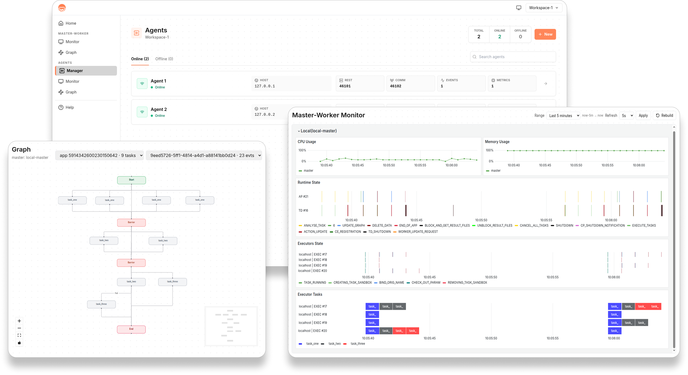

|:desktop:| Monitor
###################

**COMPSs Monitor** is a web application for observing COMPSs executions and
operating COMPSs Agents from a single interface.

Supported environments
======================

The monitor provides dedicated views for three deployment and execution
contexts:

-  **Master--Worker:** executions running on a local machine.
-  **COMPSs Agents:** Agents organized into independent workspaces.
-  **HPC environments:** executions using **Apptainer** or **Singularity**,
   optionally managed by **SLURM**.

Capabilities
============

-  **CPU and memory usage:** resource dashboards show how CPU and memory
   consumption evolve during the execution.
-  **Runtime events:** events generated by the COMPSs Runtime can be inspected
   on a timeline.
-  **API events:** calls made through the COMPSs API are displayed separately
   from Runtime events.
-  **Live tasks:** the state of the application's tasks is updated in real
   time.
-  **Live task graphs:** a dedicated view shows how tasks and their
   dependencies are created and executed while the application is running.
-  **Session history:** applications, runs, and Agent executions collected
   during the current monitoring session can be seen trough the interface.

Agent management
================

In **Agent mode**, COMPSs Monitor also acts as a manager:

-  **Workspaces:** organize independent groups of Agents.
-  **Agent status:** register Agents and check whether they are online.
-  **Resource management:** inspect and adjust local and external resources.
-  **Operations:** invoke operations through the **COMPSs Agent REST API**.
-  **Dashboards:** reconcile the Grafana dashboards associated with each
   workspace.

   COMPSs Monitor interface with Agent management, real-time execution
   metrics, and a live task dependency graph.

Enable monitoring
=========================

To export the metrics and events consumed by **COMPSs Monitor**, enable the monitor
tracing with the ``--tracing=monitor`` flag when launching the
application:

.. code-block:: console

    $ runcompss --tracing=monitor <APPLICATION> [APPLICATION_ARGUMENTS]

Use the equivalent ``--tracing=monitor`` option with ``enqueue_compss`` when
submitting an execution to a supercomputer.

.. IMPORTANT::

   **COMPSs Monitor runs separately from the COMPSs application.** Start the
   monitor before launching your application in order to receive all exported metrics and events.

   Monitoring data is persisted for as long as the monitor remains running.
   When the monitor is stopped, its persistence is reset; the next monitoring
   session starts without the data collected by the previous one.

Run the monitor
===============

How the monitor is started and connected to the execution depends on the
infrastructure. Check the corresponding instructions:

.. grid:: 1 1 2 2
    :gutter: 2

    .. grid-item-card:: Local
        :link: 02_Monitor/01_Local
        :link-type: doc
        :text-align: center

        :material-twotone:`lan;3em`

    .. grid-item-card:: Supercomputer
        :link: 02_Monitor/02_Supercomputer
        :link-type: doc
        :text-align: center

        :material-twotone:`storage;3em`

.. toctree::
    :hidden:
    :maxdepth: 3
    :caption: Table of Contents

    02_Monitor/01_Local
    02_Monitor/02_Supercomputer
