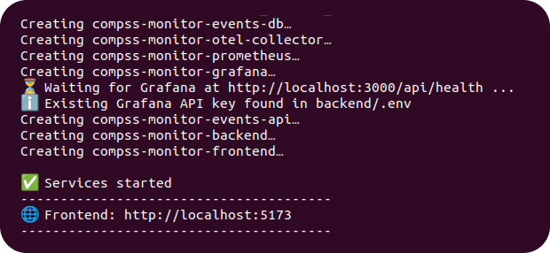
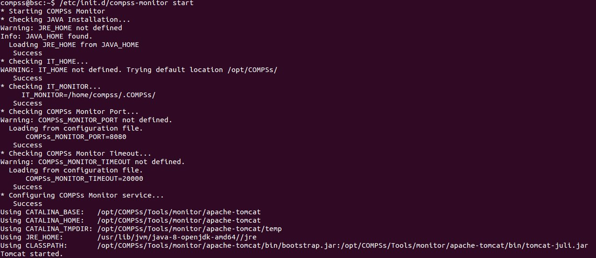

Local
*****

The local deployment runs the complete **COMPSs Monitor** stack with Docker
Compose. The installation provides commands to start and stop all the required
services from the terminal.

Requirements
============

Before installing the monitor, make sure the following dependencies are
available:

-  **Docker** to open the containerized tool.
-  **curl** to make a request to Grafana.
-  **jq** or **Python 3** to process Grafana JSON.

The Docker daemon must be running, and the current user must have permission to
use it.

Installation
============

The COMPSs Monitor repository is not public yet.

.. code-block:: console

    git clone <MONITOR_REPOSITORY_URL> compss-monitor
    cd compss-monitor
    ./install.sh

The installation script:

#. Checks that the required host tools are available.
#. Creates the backend configuration from the provided example.
#. Builds the Docker images.
#. Installs ``compss_monitor_start`` and ``compss_monitor_stop`` in
   ``$HOME/.local/bin``.

If the commands are not found after the installation, add that directory to
your ``PATH``:

.. code-block:: console

    export PATH="$HOME/.local/bin:$PATH"

Add this line to your shell configuration file to make the change permanent.

Start the monitor
=================

Start the complete monitoring stack before launching the COMPSs application:

.. code-block:: console

    compss_monitor_start

On the first startup, the command starts Grafana, creates the service-account
token required by the backend, and then starts the remaining services. This
initial startup may take longer while the containers are created.

Once the services are ready, open the web interface:

.. code-block:: text

    http://localhost:5173

   COMPSs Monitor start command output.

Run a monitored application
===========================

Enable metric and event export when launching the COMPSs application:

.. code-block:: console

    $ runcompss --tracing=monitor <APPLICATION> [APPLICATION_ARGUMENTS]

The **Monitor** view displays CPU and memory usage, Runtime and API events, and
the tasks being executed. The **Graph** view shows tasks and dependencies as
they are created and executed.

Stop the monitor
================

Stop the stack when it is no longer needed:

.. code-block:: console

    $ compss_monitor_stop

.. WARNING::

   Always run ``compss_monitor_stop`` after using the monitor. Otherwise, its
   containers remain active in the background and may continue consuming CPU,
   memory, and storage resources.

Monitoring data persists while the monitor is running. Stopping it resets this
persistence, so the next session starts without the data collected during the
previous one.

Service configuration
=====================

The COMPSs Monitor service can be configured by editing the
``/opt/COMPSs/Tools/monitor/apache-tomcat/conf/compss-monitor.conf`` file which contains
one line per property:

COMPSS_MONITOR
   Default directory to retrieve monitored applications
   (defaults to the ``.COMPSs`` folder inside the ``root`` user).

COMPSs_MONITOR_PORT
   Port where to run the compss-monitor web service (defaults to 8080).

COMPSs_MONITOR_TIMEOUT
   Web page timeout between browser and server (defaults to 20s).

Usage
=====

In order to use the COMPSs Monitor users need to start the service as
shown in :numref:`monitor_start`.

   COMPSs Monitor start command

.. TIP::

    The monitor can be started and stopped in multiple environments (local,
    docker and supercomputer) automatically using the CLI.
    Please check: :ref:`Sections/04_Ecosystem/09_CLI/03_Usage_CLI:COMPSs monitor`

And use a web browser to open the specific URL:

.. code-block:: console

    $ ./scripts/start.sh
    $ ./scripts/stop.sh
