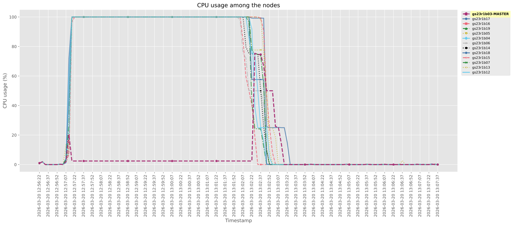
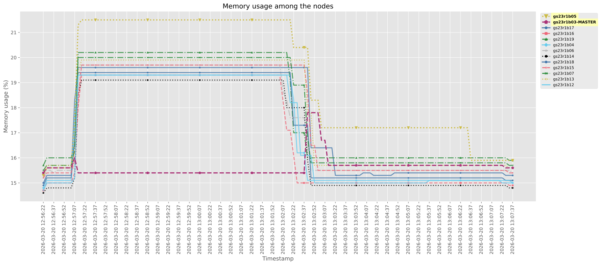

.. _resulting-crate:

Resulting crate
===============

Once the application has finished, a new sub-folder or zip file under the application's Working Directory
will be created with the name ``COMPSs_RO_Crate_[timestamp]/`` or ``COMPSs_RO_Crate_[timestamp].zip``, which is also known as *crate*. The contents of the
folder / zip file include detailed information of a COMPSs application execution (this is, the application together with
the datasets used for the run, logs, profiling, ...), and are:

- **Application Source Files:** as detailed by the user in the YAML configuration file,
  with the term ``sources``.
  The main source file and all auxiliary files that the application needs (e.g. ``.py``, ``.java``, ``.class``
  or ``.jar`` source code files, and also any installation, configuration, compilation or submission scripts, readme files, etc.)
  are included by the user. All application files are added to a sub-folder in the crate named ``application_sources/``, where
  the ``sources`` directory locations are included with their same folder tree structure, while the individual files included
  are added to the root of the ``application_sources/`` sub-folder in the crate.

- **Application Datasets:** when ``data_persistence`` is set to ``True`` in the YAML configuration file, both
  the input and output datasets of the workflow are included in the crate. The input dataset are the files that the
  workflow needs to be run. The output dataset is formed by all the resulting files generated by the execution of the
  COMPSs application. A sub-folder ``dataset/`` with all related files copied will be created, and the sub-directories
  structure will be respected. If more than a single *root* path is detected, a set of folders will be
  provided inside the ``dataset/`` folder.

- **Profiling folder:** a folder named ``profiling/`` with the aggregated plots of the resource usage of all the nodes
  involved in the execution of the application (CPU and memory, plus GPU and GPU memory if a GPU was detected).
  Plots for each individual node are not generated by default: users can invoke the ``compss_genprofiling`` command
  to generate them (see the Profiling Tool sub-section below). The resource usage data used for the plots
  (a ``csv`` file per node) is stored in ``runtime_logs/stats/``.

- **Trace folder:** if a Paraver trace file is generated during the run, and ``trace_persistence: True`` is specified in the
  YAML file, this folder will contain the trace files that correspond to the run.

- **Runtime logs folder:** a folder named ``runtime_logs/`` with the COMPSs runtime log files of the run, keeping the
  same folder structure as the log directory (see Section :ref:`Sections/03_Execution/01_Local:Logs`). It is included
  by default, and can be excluded with ``runtime_logs_persistence: False`` in the YAML file. Besides, if the debug mode
  is activated in the run, or in case some tasks fail, the ``runtime_logs/jobs/`` sub-folder will contain either all the logs
  related to task executions (debug) or only the logs of tasks that failed (in case of an execution failure).

- **complete_graph.svg:** the diagram of the workflow generated by the COMPSs runtime,
  as generated with the ``runcompss -g`` or ``--graph`` options.

- **ro-crate-info.yaml (or custom name):** the YAML workflow provenance configuration file.

- **compss-[job_id].out:** only when the execution is on a cluster. The standard output log of the job execution.

- **compss-[job_id].err:** only when the execution is on a cluster. The standard error log of the job execution.

- **ro-crate-metadata.json:** the RO-Crate JSON main file describing the contents of this directory (crate) in the
  RO-Crate specification format.

The ``ro-crate-metadata.json`` file is the central descriptor of the crate, written in the `RO-Crate specification <https://www.researchobject.org/ro-crate/>`_.
COMPSs crates support two different levels of the Workflow Run RO-Crate profile collection, each with different levels of detail:

Workflow Run Crate
------------------

This was the original profile supported by COMPSs. It provides a
**high-level description of the workflow execution**, and it focuses on the workflow as a single entity.

It contains:

- Information about the application, input datasets, and output datasets
- Execution context (e.g. submission command line, output profiles, job logs)

It is useful if you only need a broad overview of the workflow and its datasets without details of each internal step.

Provenance Run Crate
--------------------

The newly supported **Provenance Run Crate** profile extends the metadata with detailed information about each executed task.

In addition to the elements from the Workflow Run Crate, it now includes detailed
descriptions of:

- **Workflow steps**: each executed task is represented explicitly
- **Inputs and outputs of each step**: which files and datasets were consumed and produced
- **Task parameters**: the parameter values passed to each method
- **Output log files**: per task output and error logs (stored only in debug mode or if the task fails)
- **Resource usage**: overall and per computing node resource usage statistics (CPU and memory usage %, average and maximum),
  and detailed method statistics per resource (number of invocations, average, maximum and minimum execution time).
- **Enhanced Debugging**: Users can quickly diagnose issues combining the workflow diagram (``complete_graph.svg``) with
  the ``pycompss inspect`` tool that enables a quick search for information on the crate, together with the included
  error logs (both main application and task specific), which detail failures and their underlying causes.

.. TIP::
    Since its version ``3.4``, the ``PyCOMPSs CLI`` includes the capacity of inspecting RO-Crates with the
    ``pycompss inspect <crate_folder/ | crate.zip>`` command. Check the :ref:`Sections/04_Ecosystem/09_CLI/03_Usage_CLI:Inspect Workflow Provenance`
    Section for more details. The ``--verbose`` option makes it easier to explore the workflow execution in more detail.
    The ``--tasks`` option lists information about each task individually. The ``--data_assets`` option lists all the workflow's needed and generated
    datasets or files. The ``--failing_tasks`` option provides details on tasks that failed. The ``--methods`` option outputs task details
    only for the methods that their name match a certain pattern.

.. TIP::

    For the basic set of files always included for every application (i.e. ``complete_graph.svg``, ``ro-crate-info.yaml``,
    ``compss-[job_id].out``, ``compss-[job_id].err``), the runtime generates a file checksum using the ``sha256`` algorithm,
    as specified inside the metadata file ``ro-crate-metadata.json``. This checksum can be used to verify the file integrity
    with the ``sha256sum`` command.

.. WARNING::

    The ``complete_graph.svg`` is automatically generated with the ``--provenance`` flag, but it it will not be generated
    automatically if your workflow's application edges are larger than 6500, to avoid large generation times.
    If you want to generate the diagram anyway, you can trigger the diagram generation manually with ``compss_gengraph``
    or ``pycompss gengraph``.

Profiling Tool
--------------

When workflow provenance capture is enabled, the profiling tool is automatically activated. This tool collects the information
about the CPU, memory, network and disk usage (and GPU usage, if a GPU is detected) during the execution of the application,
as well as detailed statistics on the methods run.

The profiling tool is implemented in Python and it checks the files located in the ``/proc`` directory to collect the information about the resource usage of the system. This is a standard way to collect information about the system in Linux-based operating systems. However, for some architectures, such as macOS, the ``/proc`` directory is not available, so the profiling tool uses ``psutil`` to collect the information about the resource usage of the system. The profiling tool is designed to be lightweight and to have a minimal impact on the execution of the application, so it is important to use the most efficient technology available for the architecture of the machine. The profiler automatically identifies the architecture of the machine and selects the appropriate technology to collect the information about the resource usage of the system.

The profiling tool generates a set of ``csv`` files in a new folder called ``stats/`` of the log directory
(see Section :ref:`Sections/03_Execution/01_Local:Logs` for more details on where to locate these logs).
Here, the user can find a ``csv`` file corresponding to every node involved in the execution of the application
(named ``resource_profiling_<node>.csv``, with a ``static_`` prefix when the file comes from a worker, and a ``-MASTER``
suffix for the master node),
which contains the resource usage information during the execution of tasks in that node: CPU and memory usage (%),
bytes sent and received through the network, bytes read and written to disk, and time spent reading and writing to disk.
A ``csv`` example is the following:

.. code-block::
   :caption: Example of CSV file generated by the profiling tool

    CPU,MEM,BYTE_SENT,BYTE_RECV,BYTE_READ_DISK,BYTE_WRITE_DISK,TIME_READ_DISK,TIME_WRITE_DISK,TIME
    0.2,15.0,95183,98705,0,20480,0,0,2026-01-09 11:01:03
    0.2,15.0,318053,322674,0,20480,0,0,2026-01-09 11:01:08
    0.2,15.0,32282,38744,0,16384,0,0,2026-01-09 11:01:13
    0.2,15.0,38690,43424,0,4096,0,0,2026-01-09 11:01:18
    5.0,15.8,2869504,4889920,0,45056,0,1,2026-01-09 11:01:23
    94.0,17.5,3593340,980947,2826240,1003520,12,0,2026-01-09 11:01:28
    100,17.5,23196,28816,151552,127741952,29,899,2026-01-09 11:01:33
    100,17.5,279244,82911,0,9789440,0,14,2026-01-09 11:01:38
    100,17.5,76262,39312,0,36864,0,0,2026-01-09 11:01:43

When a GPU is detected in the node, two more columns are added at the end of each line: ``GPU_USAGE`` and ``GPU_MEM``
(GPU and GPU memory usage, in %).

Every record of the ``csv`` file represents a snapshot of the resource usage at a certain moment of the execution.
The interval between snapshots is determined by the ``COMPSS_PROFILING_INTERVAL`` environment variable, which by
default is set to **5 seconds**.

.. TIP::

    Users can export the value of ``COMPSS_PROFILING_INTERVAL`` environment variable to a higher value to
    reduce the profiling overhead, based on the needs of the application and the system. The value expected is
    an integer, in seconds.

Finally, the Workflow Provenance uses the ``csv`` files of the ``stats/`` folder to generate the plots of the resource usage of CPU and memory (and GPU and GPU memory, if available) of the application during its execution. By default, only the aggregated plots are generated and included in the ``profiling/`` folder of the RO-Crate, and the ``csv`` files are included in the ``runtime_logs/stats/`` folder. Users can invoke the ``compss_genprofiling`` command to generate the plots of every individual node, or of the outlier nodes only. The profiling plots can be useful to detect potential bottlenecks in the application, inefficient resource usage, and to quickly understand the resource usage of the application during its execution.

.. WARNING::

  More details about the ``compss_genprofiling`` command are explained in the :ref:`Sections/04_Ecosystem/09_CLI/03_Usage_CLI:Profiling Analytics Tool` section.

This is the list of the plots generated by the profiling.

Aggregated plots in the ``profiling/`` folder of the RO-Crate (generated by default):
  - ``cpu_aggregated.svg``: aggregated CPU usage plot of all the nodes involved in the execution of the application.
  - ``mem_aggregated.svg``: aggregated memory usage plot of all the nodes involved in the execution of the application.
  - ``gpu_aggregated.svg``: aggregated GPU usage plot of all the nodes involved in the execution of the application.
  - ``gpu_mem_aggregated.svg``: aggregated GPU memory usage plot of all the nodes involved in the execution of the application.

Individual plots in every node folder (only generated when invoking ``compss_genprofiling`` by hand, e.g. with ``--scope=all``):
  - ``cpu.svg``: CPU usage plot of each node involved in the execution of the application.
  - ``mem.svg``: memory usage plot of each node involved in the execution of the application.
  - ``gpu.svg``: GPU usage plot of each node involved in the execution of the application.
  - ``gpu_mem.svg``: GPU memory usage plot of each node involved in the execution of the application.

This is an example of the tree structure of the profiling related files that the user can find in the crate
(GPU plots only appear if a GPU was detected):

.. code-block:: console
  :caption: Example of the tree structure of the profiling related files in the crate

  profiling/
  ├── cpu_aggregated.svg
  └── mem_aggregated.svg
  runtime_logs/
  └── stats
      ├── static_resource_profiling_gs23r1b03-MASTER.csv
      ├── static_resource_profiling_gs23r1b04.csv
      ├── static_resource_profiling_gs23r1b05.csv
      ...
      └── static_resource_profiling_gs23r1b19.csv

To generate the plots of every node, the ``compss_genprofiling`` command can be run on the ``stats/`` folder of the log
directory (the exact command is printed in the output of the run, after the ``PROVENANCE | PROFILING | INFO`` label).
With ``--scope=all``, the plots of the master node are stored in a ``<node>-MASTER/`` folder, the plots of the outlier nodes
in ``outliers_cpu/``, ``outliers_memory/`` or ``outliers_cpu_memory/`` folders, and the rest in ``other_workers/``:

.. code-block:: console
  :caption: Example of the plots generated with compss_genprofiling --scope=all

  plots/
  ├── cpu_aggregated.svg
  ├── gs23r1b03-MASTER
  │   ├── cpu.svg
  │   └── mem.svg
  ├── mem_aggregated.svg
  ├── other_workers
  │   ├── gs23r1b04
  │   │   ├── cpu.svg
  │   │   └── mem.svg
  ...
  │   └── gs23r1b19
  │       ├── cpu.svg
  │       └── mem.svg
  └── outliers_memory
      └── gs23r1b05
          ├── cpu.svg
          └── mem.svg

Here is an example of the aggregated CPU and memory usage plots:

    CPU usage plot

In this plot example, it is possible to recognize the stages of the application. There is an initial idle stage correspondent to the preparation of the workload, where the CPU usage is low, followed by a stage of high CPU usage, where the application is running and consuming resources. Later there is an intermediate stage where the nodes are terminating the computation, and finally a final idle stage, where the application has finished and the CPU usage is low again. 

.. TIP::

    This stage analysis is leveraged by the statistical health reports of the ``compss_genprofiling`` command, which provide a detailed analysis of the stages of the application based on the profiling information. In :ref:`Sections/04_Ecosystem/09_CLI/03_Usage_CLI:Profiling Analytics Tool` section you can see more details.

    Memory usage plot

The profiling plots highlights in the legend the outlier nodes of the execution based on their resource usage. The outlier nodes are the nodes that have a resource usage that over-performed or under-performed the average of the other nodes. The outlier nodes are detected based on the interquartile range (IQR) of the resource usage of the nodes. The IQR is a measure of statistical dispersion, or how spread out the values are. 