.. spelling:word-list::

   Autosubmit
   Streamflow

Usage
*****

The ``pycompss-cli`` package provides the ``pycompss`` command-line tool. Note that ``compss``, ``dislib``, and ``qdislib`` are provided as aliases and can be used interchangeably with ``pycompss``.

This tool allows users to deploy and manage multiple COMPSs infrastructures from a single interface, supporting four different environment types: ``local``, ``remote``, ``docker``, and ``unicore``.

The main help output displays the supported flags and available commands:

.. code-block:: console

    $ pycompss -h
    usage: pycompss [-h] [-d] [-i] [-v] [-p] [-s] [-g]
                {tutorial,tut,environment,env,status,envs,activate,use,default,reset,wipe,dep_check,dc,install,ins,exec,e,run,r,monitor,m,jupyter,n,gengraph,gg,gentrace,gt,inspect,i} ...

    ==============
    PyCOMPSs CLI
    ==============

    A command-line tool to develop and run COMPSs applications with ease.

    Run applications locally, in Docker, or on distributed infrastructures such as
    clusters and supercomputers. The CLI handles environment setup, job submission,
    and execution management for you.

    Built for usability and reproducibility, it streamlines parallel and distributed
    computing workflows using COMPSs.

    Resources:
    • COMPSs Website             : http://compss.bsc.es
    • COMPSs Repository          : https://github.com/bsc-wdc/compss
    • COMPSs Documentation       : https://compss.readthedocs.io/
    • pycompss-cli Documentation : https://compss.readthedocs.io/en/stable/Sections/04_Ecosystem/09_CLI.html

    Supported environments in this machine:
    ✔ local: Use local COMPSs installation.
    ✔ remote: Use a remote HPC COMPSs installation.
    ✘ docker: Docker environment NOT AVAILABLE.
        Install Docker and its Python bindings ('docker') in order to enable this environment type.
    ✘ unicore: UNICORE environment NOT AVAILABLE.
        Install 'pyunicore' in order to enable this environment type.

    Current environment:
    • Name : default
    • Type : local

    positional arguments:
    {tutorial,tut,environment,env,status,envs,activate,use,default,reset,wipe,dep_check,dc,install,ins,exec,e,run,r,monitor,m,jupyter,n,gengraph,gg,gentrace,gt,inspect,i}
        tutorial (tut)      Configure the environment for COMPSs training.
        environment (env)   Manage COMPSs environments.
        status (envs)       Show current COMPSs environment status (alias of 'environment list').
        activate (use)      Activate a COMPSs environment (alias of 'environment change').
        default             Change to 'default' environment (alias of 'environment change default').
        reset (wipe)        Remove all COMPSs environments (reset state).
                            Next actions will be applied using the current environment:
        dep_check (dc)      COMPSs dependency checker.
        install (ins)       COMPSs install.
        exec (e)            Execute command within COMPSs environment.
        run (r)             Run application (with runcompss).
        monitor (m)         Start/stop monitor.
        jupyter (n)         Start Jupyter notebook.
        gengraph (gg)       Convert graph to PDF.
        gentrace (gt)       Merge traces to Paraver trace.
        inspect (i)         Inspect RO-Crate(s) in tree-colored text format.

    options:
    -h, --help            show this help message and exit
    -d, --debug           Enable debug mode.
    -i, --info            Enable info mode.
    -v, --version         Get version.
    -p, --plain           Plain mode (no color).
    -s, --sanitize        Avoid sensitive information in logs, out and err.
    -g, --gui             Graphical interface.

As seen in the help output, ``pycompss-cli`` is organized into several functional groups to simplify the lifecycle of a COMPSs application:

- **Environment Management**: Commands such as ``environment``, ``status``, and ``activate`` allow users to switch between different execution contexts (local, remote, docker, or unicore).
- **Application Execution**: The ``run`` and ``exec`` actions are the primary entry points for executing COMPSs applications and scripts within the selected environment.
- **Setup & Maintenance**: Tools like ``install`` and ``dep_check`` ensure that all necessary dependencies are present in the environment before execution.
- **Analysis & Debugging**: Advanced utilities such as ``gengraph``, ``gentrace``, and ``inspect`` provide insights into the application's execution graph and performance traces.
- **Interactive Development**: Integration with ``jupyter`` enables an interactive development process.
- **Training**: The ``tutorial`` action automatically creates and configures training environments.

.. IMPORTANT::

   Not all environments support every action. Some environments may offer additional capabilities (e.g., remote environments provide ``app`` and ``job`` actions). Supported actions are displayed once the environment is active.

.. TIP::

   Most commands provide a short alias (e.g., ``env`` for ``environment``, ``r`` for ``run``) to speed up the workflow in the terminal.

.. TIP::

    A Graphical User Interface (GUI) is also available and can be launched with:

    .. code-block:: console

        $ pycompss --gui

    The GUI allows all actions to be performed via a mouse-driven interface.

Creating a New COMPSs Environment
=================================

First, navigate to your development directory:

.. code-block:: console

    mkdir pycompss_projects
    cd pycompss_projects

New environments can be created in two ways:

1. **Automatically** using the ``tutorial`` (``tut``) action:

   .. code-block:: console

       $ pycompss tutorial <TUTORIAL_NAME>

   * If ``<TUTORIAL_NAME>`` is left empty, the generic PyCOMPSs tutorial Docker environment will be deployed.

2. **Manually** using the ``environment`` (``env``) action:

   .. code-block:: console

       $ pycompss environment init

   The system will prompt you for the necessary information (e.g., environment type, name, etc.).

.. dropdown:: Advanced environment initialization

  .. tab-set::

    .. tab-item:: Local
        :sync: local

        Creates a local environment and initializes COMPSs in the current working directory.

        .. code-block:: console

            $ pycompss environment init local

        Alternatively, you can specify a custom working directory:

        .. code-block:: console

            $ pycompss init local -w /home/user/replace/path/

    .. tab-item:: Docker
        :sync: docker

        Creates a Docker-based environment and deploys a COMPSs container.

        .. code-block:: console

            $ pycompss environment init docker

        .. TIP::

            This command initializes COMPSs in the current working directory, allowing you to share it with the container (develop locally and test within Docker), or in the ``WORK_DIR`` if the ``-w`` flag is set. You can specify the COMPSs Docker image to be used with the ``-i`` flag.

        .. IMPORTANT::

            **For macOS users**:

            If the command ``pycompss init docker`` returns the following error:

            .. code-block:: console

                "ERROR: Docker service is not running. Please, start docker service and try again"

            Even if Docker is running correctly, this may be caused by ``pycompss-cli`` being unable to find the Docker socket in the default path.
            To fix this: Open **Docker Desktop** > **Settings** > **Advanced** (in the left panel) > **Enable default Docker socket**.

        .. NOTE::

                The first initialization requires downloading the Docker image from the repository, which may take some time.

    .. tab-item:: Remote
        :sync: remote

        Creates a remote environment where COMPSs is already available. You will be prompted for the required configuration.

        .. code-block:: console

            $ pycompss environment init remote

        .. TIP::

            You can use a configuration file to set up the remote environment using the ``--setup_file`` flag. For example, to load specific modules:

            .. code-block:: text

                $ cat remote_setup.sh
                module load python/3.12.1
                module load COMPSs/3.4
                module load <ANY_OTHER_MODULE>
                $ pycompss environment init remote --setup_file remote_setup.sh

    .. tab-item:: UNICORE
        :sync: unicore

        Creates a UNICORE environment where COMPSs is available. You will be prompted for the required configuration.

        .. code-block:: console

            $ pycompss environment init unicore

Managing Environments
=====================

Environments can be managed using the following actions:

- **Listing**: Check all available environments using ``environment list`` (shortcuts: ``env l``, ``status``, or ``envs``).

    .. code-block:: console

        $ pycompss env list
        ┌──────────┬────────┬────────┐
        │ Name     │ Type   │ Active │
        ├──────────┼────────┼────────┤
        │ test_env │ remote │   -    │
        │ tutorial │ docker │   -    │
        │ default  │ local  │   ✔   │
        └──────────┴────────┴────────┘

- **Changing**: Activate a specific environment using ``environment change <NAME>`` (shortcuts: ``env c``, ``activate``, or ``use``). Use ``default`` to switch back to the default environment.

    .. code-block:: console

        $ pycompss env change tutorial
        ⚠️  WARNING: The 'tutorial' container is not running. Starting...
        ⚠️  WARNING: No master container running.
        Starting pycompss-master-tutorial container in dir /home/user/temp
        This may take a while because it needs to download the docker image. Please be patient. ✔
        Environment `tutorial` is now active

- **Analyzing**: View the details of the currently active environment using ``environment show`` (shortcut: ``env s``).

    .. code-block:: console

        $ pycompss environment show
        ⚙️  Environment `tutorial` configuration:
        - name: tutorial
        - specific:
        - image: compss/compss-tutorial:3.4
        - restart: True
        - privileged: False
        - update_image: False
        - master_ip: 172.17.0.3
        - working_dir: /home/user/temp
        - log_dir: /home/user/temp/.COMPSs/
        - env: docker
        🛠️  Environment `tutorial` setup script:
        echo 'not needed'

- **Removing**: Delete a specific environment using ``environment remove <NAME>`` (shortcut: ``env r``).

    .. code-block:: console

        $ pycompss environment remove test_env
        ⚠️  Are you sure to remove the 'test_env' environment? [y/n]: y
        Deleting environment `test_env`. ..

- **Resetting**: Remove all configured environments using ``reset`` or ``wipe`` (**USE WITH CAUTION**).

    .. code-block:: console

        $ pycompss reset
        ⚠️  The /home/user/temp/.COMPSs folder will be removed. Do you want to continue? [y/n]: y
        ⚠️  The /home/user/temp/.compss_docker_cfg file will be removed. Do you want to continue? [y/n]: y
        ⚠️  Are you sure to remove the 'tutorial' environment? [y/n]: y
        Removing current active environment. Changing to default environment.
        Environment `default` is now active
        Deleting environment `tutorial`. ..

Available Actions
=================

The following table summarizes the available actions and their compatibility with different environment types. Note that not all actions are supported across all environments.

+-----------------------------------------------+---------+---------+---------+---------+
| Action\\Environment                           | Local   | Docker  | Remote  | Unicore |
+===============================================+=========+=========+=========+=========+
| Check COMPSs dependencies (``dep_check``)     |    ✔    |         |         |         |
+-----------------------------------------------+---------+---------+---------+---------+
| Install COMPSs (``install``)                  |    ✔    |         |         |         |
+-----------------------------------------------+---------+---------+---------+---------+
| Execute command (``exec``)                    |    ✔    |    ✔    |    ✔    |         |
+-----------------------------------------------+---------+---------+---------+---------+
| Execute COMPSs application (``run``)          |    ✔    |    ✔    |         |         |
+-----------------------------------------------+---------+---------+---------+---------+
| Manage application (``app``)                  |         |         |    ✔    |    ✔    |
+-----------------------------------------------+---------+---------+---------+---------+
| Manage job (``job``)                          |         |         |    ✔    |    ✔    |
+-----------------------------------------------+---------+---------+---------+---------+
| COMPSs Monitor (``monitor``)                  |    ✔    |    ✔    |    ✔    |         |
+-----------------------------------------------+---------+---------+---------+---------+
| Jupyter Notebook (``jupyter``)                |    ✔    |    ✔    |    ✔    |         |
+-----------------------------------------------+---------+---------+---------+---------+
| Generate the task graph (``gengraph``)        |    ✔    |    ✔    |    ✔    |         |
+-----------------------------------------------+---------+---------+---------+---------+
| Tracing applications/notebooks (``gentrace``) |    ✔    |    ✔    |    ✔    |         |
+-----------------------------------------------+---------+---------+---------+---------+
| Add/Remove COMPSs workers (``components``)    |         |    ✔    |         |         |
+-----------------------------------------------+---------+---------+---------+---------+
| Inspect workflow provenance (``inspect``)     |    ✔    |         |         |         |
+-----------------------------------------------+---------+---------+---------+---------+

Checking COMPSs Dependencies
----------------------------

This action verifies the COMPSs dependencies within the active environment. It is critical to ensure that all required dependencies are installed before attempting to install COMPSs to avoid errors.

Since COMPSs supports multiple programming languages, the dependency check can be performed using different profiles.

.. code-block:: console

        $ pycompss dep_check
        ❓ Select your profile [minimal | full | Python | C | custom] (default: Python): Python

        SYSTEM PACKAGES
        ---------------
        ✔ java (21.0.1)
        ✔ uuidgen (2.31.1)
        ✔ ssh (15.0)
        ✔ autoreconf (2.69)
        ✔ libtool (15.0)
        ✔ gfortran (7.4.1)
        ✔ libxml2-dev (15.0)
        ✔ make (4.2.1)
        ✔ build-essential (15.0)
        ✔ python (3.12.13)
        ✔ python3-pip (26.0.1)
        ✔ python3-dev (15.0)

        OTHER PACKAGES
        --------------
        ✔ docker (26.1.5)
        ⚠ nodejs [OPTIONAL] NodeJS>=12 Required for the new COMPSs monitor

        PYTHON PACKAGES
        ---------------
        ✔ setuptools (84.0.0)
        ✔ wheel (0.47.0)
        ✖ cython
        ✔ dill (0.4.1)
        ⚠ guppy3 [OPTIONAL] Enables the memory usage reporting
        ⚠ tabulate [OPTIONAL] Enables the runtime status data tables in notebooks
        ⚠ matplotlib [OPTIONAL] Enables the runtime status plots in notebooks and the object tracker report plot
        ⚠ numpy [OPTIONAL] Enables the runtime status information in notebooks
        ✔ memory_profiler (0.61.0)
        ⚠ mpi4py [OPTIONAL] Enables the usage of the MPI Python worker
        ✔ mypy (2.3.1)
        ✔ jupyter (2.3.1)
        ✔ jupyterlab (4.6.3)

        R PACKAGES
        ----------

        ENVIRONMENT VARIABLES
        ---------------------
        ✔ JAVA_HOME

        ---------------------------------------
        | Missing REQUIRED dependencies detected |
        ------------------------------------------
        HINT! Here are the commands to install them:
        python3 -m pip install "cython"

        ------------------------------------------
        | Missing OPTIONAL dependencies detected |
        ------------------------------------------
        HINT! Here are the commands to install them:
        sudo zypper install nodejs
        python3 -m pip install "guppy3>=3.0.1"
        python3 -m pip install "tabulate>=0.8.8"
        python3 -m pip install "matplotlib>=3.5.0"
        python3 -m pip install "numpy>=2.2.0"
        python3 -m pip install "mpi4py>=3.1.1"

        ⚠️  Do you want to attempt to install REQUIRED missing dependencies? [y/n]: n
        ⚠️  Do you want to attempt to install OPTIONAL missing dependencies? [y/n]: n

        ☠️  ERROR: Missing REQUIRED dependencies found! ❌

The output indicates whether the system meets all required dependencies. If not, it specifies which are missing, their importance (mandatory vs. optional), and provides the commands to install them.

Installing COMPSs
-----------------

This action installs COMPSs within the active environment. The dependency check must be successful before the installation can proceed.

.. code-block:: console

    $ pycompss install
    ❓ Select the installation profile [full | minimal | C | Python | R] (default: Python): Python
    Installing COMPSs with profile: Python
    1. Check dependencies...

    SYSTEM PACKAGES
    ---------------
    ✔ java (21.0.1)
    ✔ uuidgen (2.31.1)
    ✔ ssh (15.0)
    ✔ autoreconf (2.69)
    ✔ libtool (15.0)
    ✔ gfortran (7.4.1)
    ✔ libxml2-dev (15.0)
    ✔ make (4.2.1)
    ✔ build-essential (15.0)
    ✔ python (3.12.13)
    ✔ python3-pip (26.0.1)
    ✔ python3-dev (15.0)

    OTHER PACKAGES
    --------------
    ✔ docker (26.1.5)
    ⚠ nodejs [OPTIONAL] NodeJS>=12 Required for the new COMPSs monitor

    PYTHON PACKAGES
    ---------------
    ✔ setuptools (84.0.0)
    ✔ wheel (0.47.0)
    ✔ cython (3.3.0)
    ✔ dill (0.4.1)
    ⚠ guppy3 [OPTIONAL] Enables the memory usage reporting
    ⚠ tabulate [OPTIONAL] Enables the runtime status data tables in notebooks
    ⚠ matplotlib [OPTIONAL] Enables the runtime status plots in notebooks and the object tracker report plot
    ⚠ numpy [OPTIONAL] Enables the runtime status information in notebooks
    ✔ memory_profiler (0.61.0)
    ⚠ mpi4py [OPTIONAL] Enables the usage of the MPI Python worker
    ✔ mypy (2.3.1)
    ✔ jupyter (2.3.1)
    ✔ jupyterlab (4.6.3)

    R PACKAGES
    ----------

    ENVIRONMENT VARIABLES
    ---------------------
    ✔ JAVA_HOME

    ------------------------------------------
    | Missing OPTIONAL dependencies detected |
    ------------------------------------------
    HINT! Here are the commands to install them:
    sudo zypper install nodejs
    python3 -m pip install "guppy3>=3.0.1"
    python3 -m pip install "tabulate>=0.8.8"
    python3 -m pip install "matplotlib>=3.5.0"
    python3 -m pip install "numpy>=2.2.0"
    python3 -m pip install "mpi4py>=3.1.1"

    ⚠️  Do you want to attempt to install OPTIONAL missing dependencies? [y/n]: n

    All REQUIRED dependencies satisfied! ✅
    ❓ 🏷️  Which COMPSs version? (default: 3.4): 
    COMPSs version: 3.4
    2. Downloading package...
    Downloading [██████████████████████████████] 100.0% (863.6 MB / 882.2 MB) | 57.7 MB/s
    3. Extracting package...
    Extracting  [█████████████████████████░░░░░]  84.8% (20.6 KB / 24.3 KB) | 2.3 KB/
    ...
    ...
    ...

During this process, the tool will prompt you for details such as the COMPSs version and the installation path.

Executing Commands
------------------

This action executes a given command (and its parameters) within the active environment.

For example, in a **local** environment:

.. code-block:: console

    $ pycompss exec whoami
    user

In a **Docker** environment:

.. code-block:: console

    $ pycompss exec whoami
    root

Executing Applications with COMPSs
----------------------------------

This action runs a specified application and its parameters using COMPSs within the active environment.

.. code-block:: console

    $ # pycompss run [COMPSs FLAGS] [APPLICATION] [APPLICATION PARAMETERS]
    $ pycompss run --graph --tracing examples/mandelbrot/src/mandel.py 2
    [...]

Managing Applications (Remote)
------------------------------

Remote environments require applications to be deployed before they can be executed. The ``app`` argument provides tools for deploying, listing, and removing applications (available only when a remote environment is active).

**Deploying an Application**
^^^^^^^^^^^^^^^^^^^^^^^^^^^^

The ``app deploy`` action copies the current directory to the remote machine, making it ready for execution as a job in the queuing system.

.. code-block:: console

    $ pycompss app deploy notebooks
    Deploying app...

.. TIP::

    Use the ``--overwrite`` flag to re-deploy an application and overwrite existing remote contents.

**Listing Applications**
^^^^^^^^^^^^^^^^^^^^^^^^

You can view all deployed applications in the remote environment using the ``app list`` action:

.. code-block:: console

    $ pycompss app list
    ┌───────────┐
    │ Name      │
    ├───────────┤
    │ notebooks │
    └───────────┘

**Removing an Application**
^^^^^^^^^^^^^^^^^^^^^^^^^^^

Remove an application from the remote machine using the ``app remove`` action:

.. code-block:: console

    $ pycompss app remove notebooks
    ⚠️  Are your sure that you want to remove notebooks app? [y/n]: y
    Application `notebooks` removed successfully

Managing Jobs (Remote)
----------------------

Remote environments execute applications via a job management system (e.g., SLURM). The ``job`` action allows users to submit, monitor, cancel, and review the history of these jobs.

**Submitting a Job**
^^^^^^^^^^^^^^^^^^^^

Use ``job submit`` to launch the execution of a COMPSs application. Note that the application must be deployed first.

.. code-block:: console

   $ # pycompss job submit --app_name [APPLICATION NAME] [ENQUEUE_COMPSS_FLAGS] [APLICATION MAIN FILE] [APPLICATION FLAGS]
   $ pycompss job submit --app_name examples --exec_time=10 --qos=debug --num_nodes=2 --project_name=bsc main.py 2 3
   [...]
   1234 # [JOB_IDENTIFIER]

**Checking Job Status**
^^^^^^^^^^^^^^^^^^^^^^^

Consult the current status of a job (e.g., running, waiting) using the ``job status`` action:

.. code-block:: console

   $ # pycompss job status [JOB_IDENTIFIER]
   $ pycompss job status 1234
   RUNNING

**Canceling a Job**
^^^^^^^^^^^^^^^^^^^

If an issue is detected, a job can be canceled while it is waiting or running via the ``job cancel`` action:

.. code-block:: console

   $ # pycompss job cancel [JOB_IDENTIFIER]
   $ pycompss job cancel 1234

**Listing Current Jobs**
^^^^^^^^^^^^^^^^^^^^^^^^

View all jobs currently in the queue or in execution using the ``job list`` action:

.. code-block:: console

    $ pycompss job list
    [...]

**Reviewing Job History**
^^^^^^^^^^^^^^^^^^^^^^^^^

Check the history of all submitted jobs using the ``job history`` action:

.. code-block:: console

    $ pycompss job history
    [...]

.. TIP::

    You can limit the history to a single job by specifying the ``--job_id`` flag followed by the job identifier.

COMPSs Monitor
--------------

The COMPSs monitor can be started in the active environment using the ``pycompss monitor start`` command. This enables real-time monitoring of the application status. Once started, the tool will provide a URL to access the monitor via a web browser (e.g., ``http://127.0.0.1:8080/compss-monitor``).

.. IMPORTANT::

    Include the ``--monitoring=<REFRESH_RATE_MS>`` flag in the execution command before the binary to be executed.

.. code-block:: console

    $ pycompss monitor start
    $ pycompss run --monitoring=1000 -g matmul_files.py 4 4
    $ # During the execution, go to the URL in your web browser
    $ pycompss monitor stop

When running a notebook, simply add the monitoring parameter to the COMPSs runtime start call. To stop the monitoring facility, use the ``pycompss monitor stop`` command.

.. TIP::

    The new monitor can be used instead of the traditional one by adding the ``--new_monitor`` flag. Note that this requires Docker or Apptainer to be available in the active environment.

Jupyter Notebooks
-----------------

Jupyter notebooks can be launched using the ``pycompss jupyter`` command. Run the following snippet from the project root:

.. code-block:: console

    $ cd tutorial_apps/python
    $ pycompss jupyter ./notebooks

You can then access the notebook interactively by opening the provided URL (e.g., ``http://127.0.0.1:8888/``) in your web browser.

To run a Jupyter notebook on a remote environment, it must be bound to a previously deployed application:

.. code-block:: console

    $ pycompss jupyter --app_name notebooks --exec_time=20 --qos=gp_debug --num_nodes=1 --project_name=bsc
    Job submitted: 19320191
    Waiting for jupyter to start...
    Connecting to jupyter server...
    Connection established. Please use the following URL to connect to the job.
    http://localhost:8888/?token=35199bb8917a97ef2ed0e7a97fbfb6e4c727983bb3a87483
    Ready to work!
    To force quit: CTRL + C

Inside the notebook, PyCOMPSs must be imported and the runtime started. For more details, please refer to the following resources:

- `PyCOMPSs programming model <https://pycompss.readthedocs.io/en/stable/Sections/02_App_Development/02_Python/01_Programming_model.html>`_
- `Jupyter API (pycompss start, stop, etc.) <https://pycompss.readthedocs.io/en/stable/Sections/TO_RELOCATE/PYTHON/03_Jupyter_integration.html>`_
- `Sample notebooks <https://pycompss.readthedocs.io/en/stable/Sections/08_PyCOMPSs_Notebooks.html>`_
- `Tutorial <https://pycompss.readthedocs.io/en/stable/Sections/08_Tutorial/02_PyCOMPSs.html>`_

.. CAUTION::

    If the job's walltime is reached, the queuing system will kill the job, and the notebook will stop working.

To finish your session, press ``CTRL+C`` in the console where you launched the ``pycompss jupyter`` command to trigger the job cancellation.

Generating the Task Graph
-------------------------

COMPSs can produce a task graph showing the dependencies respected during execution. To generate it, include the ``--graph`` flag in the execution command:

.. code-block:: console

    $ cd python/matmul_files/src
    $ pycompss run --graph matmul_files.py 4 4

Once the application finishes, the graph is stored in the ``.COMPSs\app_name_XX\monitor\complete_graph.dot`` file. This `.dot` file can be converted to PDF (or other formats) for easier visualization using the ``gengraph`` action:

.. code-block:: console

    $ pycompss gengraph .COMPSs/matmul_files.py_01/monitor/complete_graph.dot

The resulting PDF will be stored in the same folder as the `.dot` file.

Tracing Applications and Notebooks
----------------------------------

COMPSs can produce tracing profiles of application execution using EXTRAE. To enable this, include the ``--tracing`` flag in the execution command:

.. code-block:: console

    $ cd python/matmul_files/src
    $ pycompss run --tracing matmul_files.py 4 4

If running a notebook, simply add the tracing parameter to the ``pycompss jupyter`` call. Once the application finishes, the trace is stored in the ``~\.COMPSs\app_name_XX\trace`` folder and can be analyzed with Paraver.

In remote environments, the trace folder contains a set of ``tar.gz`` files. To process and merge these into final trace files (``prv``, ``pcf``, and ``row``), use the ``gentrace`` action:

.. code-block:: console

    $ pycompss gentrace ~\.COMPSs\app_name_XX\trace

Adding and Removing COMPSs Workers
----------------------------------

The ``pycompss-cli`` can add or remove worker nodes in Docker environments using the ``components`` argument. Use ``list`` to view current containers, ``add`` to add new worker containers, and ``remove`` to delete a worker. These actions can be performed before running an application.

**Listing Nodes**
^^^^^^^^^^^^^^^^^

.. code-block:: console

    $ pycompss components list
    pycompss-master-tutorial

**Adding Nodes**
^^^^^^^^^^^^^^^^

.. NOTE::

    Adding nodes is currently in the beta phase. Please report issues or suggestions on `Github <https://github.com/bsc-wdc/>`__.

To add computing nodes, specify the number of workers to be added. For example, to add 2 Docker workers:

.. code-block:: console

    $ pycompss components add worker 2
    Started 2 worker/s
    Working dir: /home/user/examples
    CPUs: 4

You can verify the new nodes are active with:

.. code-block:: console

    $ pycompss components list
    pycompss-master-tutorial
    pycompss-worker-tutorial-9ab82397
    pycompss-worker-tutorial-7c0a9326

**Removing Nodes**
^^^^^^^^^^^^^^^^^^

.. NOTE::

    Removing nodes is currently in the beta phase. Please report issues or suggestions on `Github <https://github.com/bsc-wdc/>`__.

To remove computing nodes, specify the number of workers to be removed. For example, to remove 1 Docker worker:

.. code-block:: console

    $ pycompss components remove worker 2
    Removed 1 workers.

Verify the removal with:

.. code-block:: console

    $ pycompss components list
    pycompss-master-tutorial
    pycompss-worker-tutorial-7c0a9326

Inspect Workflow Provenance
---------------------------

As detailed in the :ref:`Sections/04_Ecosystem/05_Workflow_Provenance:|:spy:| Workflow Provenance` section, COMPSs can generate workflow provenance as metadata stored using the RO-Crate specification.

The ``pycompss inspect`` command reads an existing RO-Crate and prints its content in a user-friendly format. The RO-Crate can be a subdirectory or a zip file containing the ``ro-crate-metadata.json`` file in its root. Note that Docker and Remote options for this command are not yet implemented.

The ``inspect`` option supports several specific flags:

.. code-block:: console

    $ pycompss inspect -h
    usage: pycompss inspect <ro_crate> [<ro_crate> ...] [flags]

    positional arguments:
      ro_crate              Folder or zip file(s) containing the RO-Crate(s).

    options:
      -h, --help            show this help message and exit
      -v, --verbose         Print extra information about tasks.
      -d, --data_assets     Print data assets.
      -f, --failing_tasks   Print info about failing tasks only.
      -t [TASKS], --tasks [TASKS]
                            Print info about one or more tasks, comma-separated (e.g. 4,7,10-11,15-18). Without a value, print all tasks.
      -m [METHODS], --methods [METHODS]
                            Print all tasks executing the specified method(s), comma-separated (e.g. multiply,add). Without a value, print all tasks.
      --order_time          With -m/-t/-f, print tasks in chronological order (start time).
      --order_host          With -m/-t/-f, print tasks grouped by host, in chronological order (start time) within each host (already includes --order_time).

By default, the output displays the application's **Name**, **Description**, **Authors** (name, organization, and email), **License**, and **Date Published**. It also identifies the **Main entity** (main file) and the **Programming language** and version used.

In the **Execution details** section, it shows the run **Status**, a summary of **Executed Tasks**, the total **Execution Time**, and the **Host** (hostname, number of nodes, and job ID if a queuing system was used). **Resource Usage** provides the average CPU and Memory percentage used by the nodes (excluding the master). The **Agent** field identifies the individual who executed the application.

.. TIP::

    Wildcards can be used with ``pycompss inspect`` to retrieve details for multiple runs simultaneously. You can also filter the output using ``grep`` (e.g., ``pycompss inspect *.zip | grep -e CRATE -e "Execution Time"``).

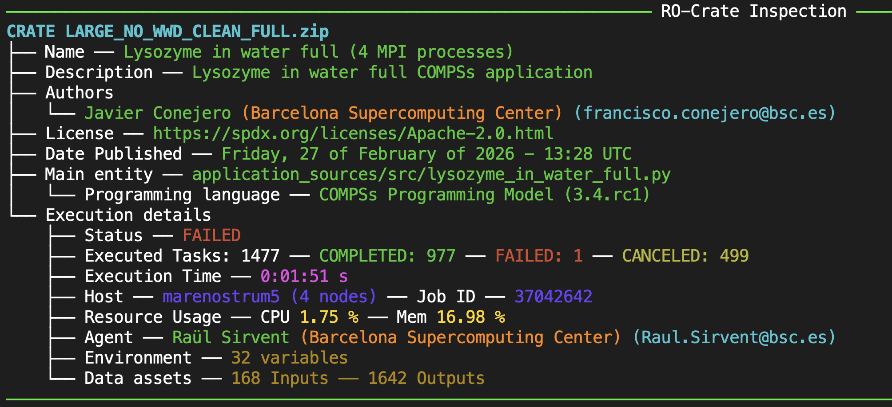

    Inspect without flags

**Verbose Mode**
^^^^^^^^^^^^^^^^

The ``-v/--verbose`` flag prints detailed general information. Specifically, the **Software Requirements** and **RO-Crate compliance** fields are added to the general description.

The **Execution details** are significantly expanded to include:

- **Start and End Time** in UTC format.
- **Submission**: The exact command used to run the experiment.
- **Environment**: Relevant environment variables captured during execution.
- **Resource Usage**: Detailed statistics per node, including method-specific performance.

The **Overall Statistics** section provides a breakdown of all executed methods: number of invocations, and average, maximum, and minimum execution times in milliseconds. It also provides average CPU and memory usage across all worker nodes. Finally, it lists details per node (hostname and tasks executed), providing per-method statistics and resource usage (avg/max CPU and avg/max/min memory). This is highly useful for identifying performance bottlenecks or load imbalance between nodes.

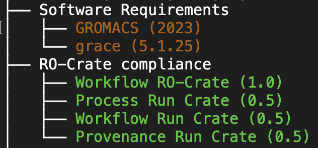

    Inspect extra general details

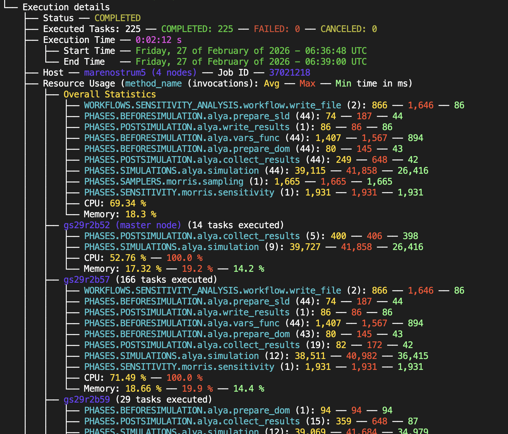

    Inspect verbose, providing method and resource usage statistics

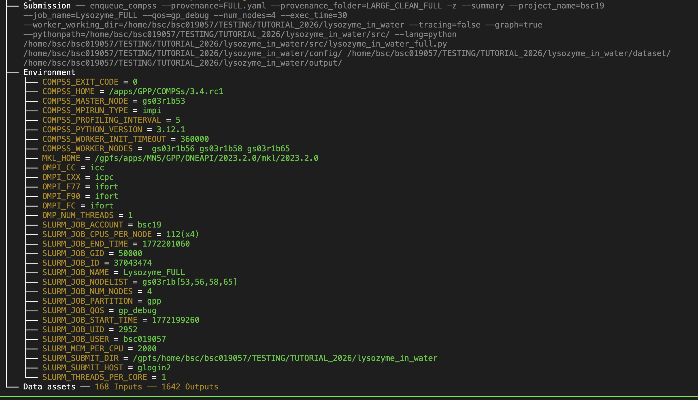

    Detail on submission command and environment variables inside the Execution details section

**Listing Data Assets**
^^^^^^^^^^^^^^^^^^^^^^^

The ``-d/--data_assets`` flag provides details on the inputs used and outputs generated. This is disabled by default because large experiments can produce an overwhelming number of files. Each asset is specified by a relative path (if persisted in the crate) or a URL. For directories, only the root name is listed; for files, the size is also shown.

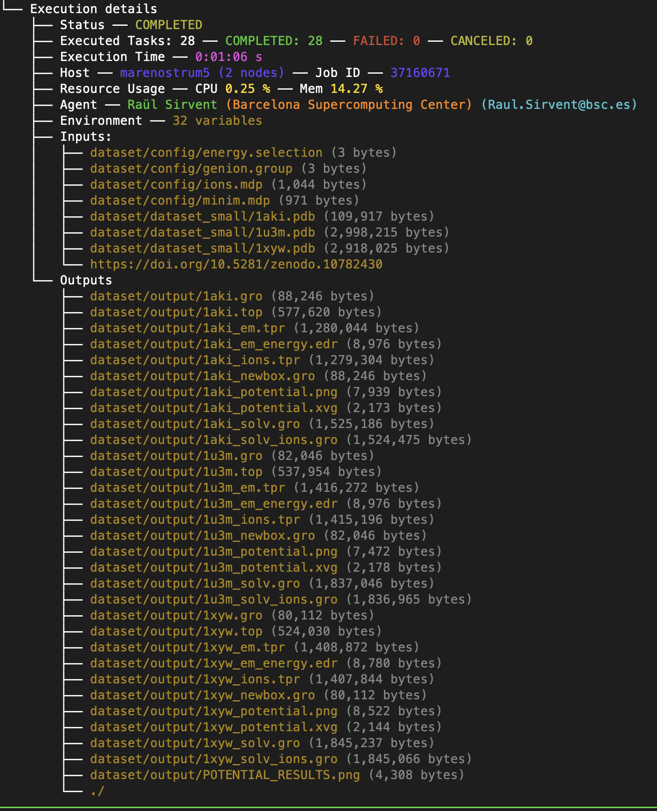

    Detail on datasets needed (Inputs) and generated (Outputs) by the workflow application. Since relative paths are used, the datasets are persisted in the crate

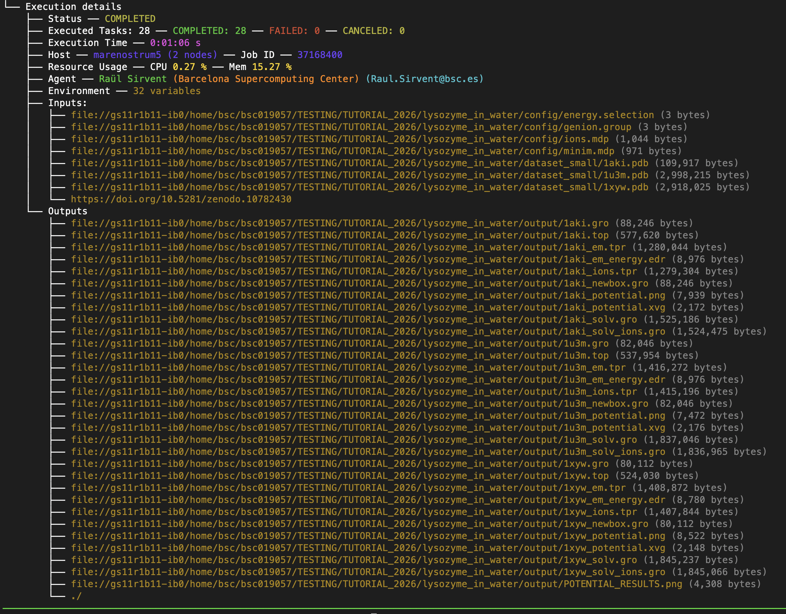

    Detail on datasets needed (Inputs) and generated (Outputs) by the workflow application. Since URLs are used, the datasets are not persisted in the crate

**Task Details by ID**
^^^^^^^^^^^^^^^^^^^^^^

The ``-t/--tasks`` flag prints detailed information for specific tasks. It accepts a comma-separated list of individual IDs (e.g., ``-t 3,4,10``), ranges (e.g., ``-t 20-30``), or combinations of both (e.g., ``-t 3,4,20-30``). Without a value, all tasks are printed. The RO-Crate path can be given before or after the flags:

.. code-block:: console

    $ pycompss inspect my_crate.zip -t 3,4,20-30
    $ pycompss inspect -t 3,4,20-30 my_crate.zip

Details include status, the method executed, execution time, the host, and parameters (with their type and value). The **Type** field shows the ``schema.org`` mapping followed by the original programming model type (e.g., ``float64``, ``dict``). For failed or canceled tasks, output parameters are not listed as they are unreliable. In these cases, the **Execution Time** represents the time elapsed before the failure occurred.

.. TIP::

    We **STRONGLY** recommend using the workflow diagram (``complete_graph.svg``) to identify task ID numbers before using the ``-t`` flag.

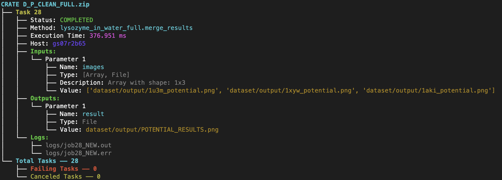

    Task details: examples on Array of Files and File parameters. Corresponding task execution log files are also listed

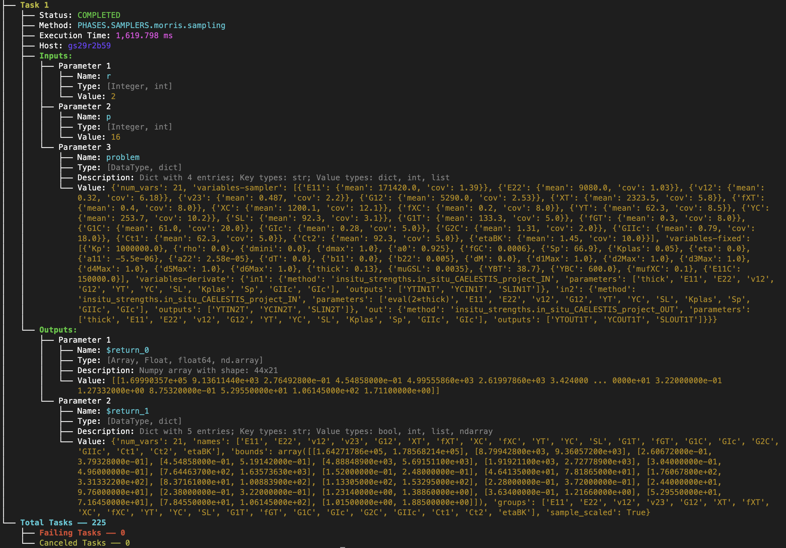

    Task details: examples with Integer, Dictionary and Numpy array parameters

**Task Details by Method Name**
^^^^^^^^^^^^^^^^^^^^^^^^^^^^^^^

Similarly to the ``-t`` flag, the ``-m/--methods`` flag filters tasks by the name of the method they executed. It accepts a comma-separated list of method names or regular expressions (e.g., ``-m multiply,add``), and prints the tasks whose method name contains any of them (e.g., ``multiply`` matches ``matmul_tasks.multiply``). Without a value, all tasks are printed.

**Task Order**
^^^^^^^^^^^^^^

By default, the tasks selected with ``-t``, ``-m`` or ``-f`` are printed in the order in which they appear in the RO-Crate. Two flags change this order:

- ``--order_time``: prints the tasks in chronological order (by start time).
- ``--order_host``: groups the tasks by host and, within each host, prints them in chronological order (it already includes ``--order_time``).

.. code-block:: console

    $ pycompss inspect my_crate.zip -m multiply --order_host

**Failing Tasks**
^^^^^^^^^^^^^^^^^

The ``-f/--failing_tasks`` flag lists only the tasks that failed during execution. Since provenance is generated regardless of outcome, this is an essential tool for debugging. Failing tasks always include their related execution logs and the exact input values used, allowing users to pinpoint the source of the error.

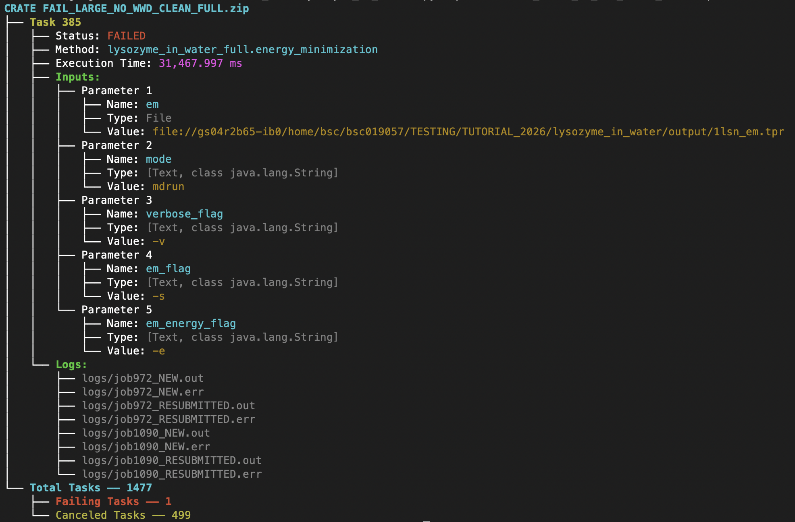

    Details on Task 385 that failed. We can see that both Inputs and execution logs are indicated so the user can check them to look for errors

**Compatibility with other WMSs**
^^^^^^^^^^^^^^^^^^^^^^^^^^^^^^^^^

Because it is compliant with RO-Crate (specifically the Workflow Run and Provenance Run profiles), the ``pycompss inspect`` functionality is **interoperable with other Workflow Management Systems (WMSs)** that generate metadata in this format.

Examples include: **CWL, Nextflow, Galaxy, Autosubmit, WfExS, Streamflow, Snakemake, Sapporo**, and others. Note that the level of detail printed may vary depending on the amount of metadata provided by the source WMS.

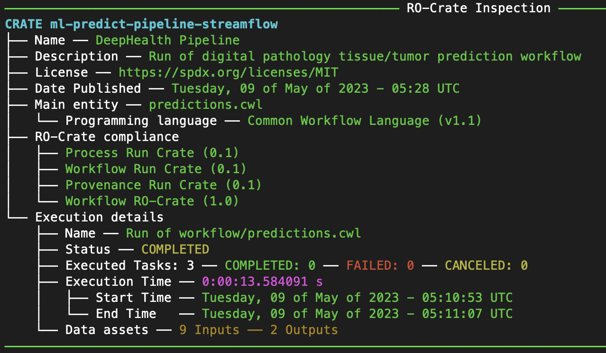

    Streamflow pipeline details obtained with pycompss inspect

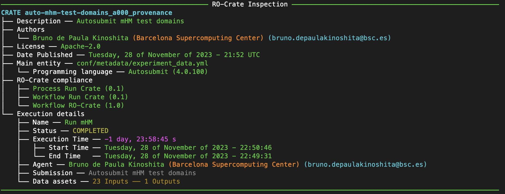

    Autosubmit pipeline details obtained with pycompss inspect

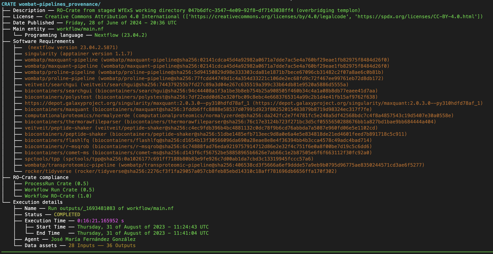

    WfExS pipeline details obtained with pycompss inspect

Profiling Analytics Tool
------------------------

Introduction & Core Capabilities
^^^^^^^^^^^^^^^^^^^^^^^^^^^^^^^^

When running distributed applications with COMPSs, understanding how your cluster utilizes resources is crucial for optimizing performance and uncovering bottlenecks. The **COMPSs Resource Usage Analysis & Plotting Tool** is a command-line utility designed to ingest per-node CSV statistics from a COMPSs run and automatically transform raw data into actionable visual and statistical insights.

The tool streamlines your post-run analysis by automatically generating three primary outputs:

- **Individual Node Plots:** Time-series plots mapped per metric (CPU, Memory, GPU, and GPU Memory) to give you a granular look at how specific machines behaved.
- **Aggregated Cluster Plots:** Multinode charts designed to show the big picture and immediately highlight statistical outliers across your infrastructure.
- **Statistical Health Reports:** Deep-dive cluster analytics that provide automatic outlier detection, execution-phase inference, and load-imbalance warnings.

To fit seamlessly into different workflows, the tool operates in two distinct modes. If you prefer a guided experience, the **Interactive Mode** takes you through configuration step-by-step. Alternatively, for automatic scripts such as the Workflow Provenance, the **Silent Mode** bypasses all the user interaction using command-line flags.

Input Data Requirements
^^^^^^^^^^^^^^^^^^^^^^^

Before running the tool, ensure your data directory is structured
correctly. The utility expects one CSV file per node. To identify which
machine is which, the tool parses the filename, extracting the machine
name from the string following the very last underscore and before the
``.csv`` extension.

Column Specifications
"""""""""""""""""""""

The data parsing logic distinguishes between mandatory data and optional
enhancements:

-  **Required Columns:** Every CSV must contain ``TIME`` (parsed as a
   datetime timestamp), ``CPU`` (usage percentage), and ``MEM`` (memory
   usage percentage). If a file lacks any of these three core columns,
   it will be silently skipped.
-  **Optional Columns:** If your cluster tracks accelerators, you can
   include ``GPU_USAGE`` and ``GPU_MEM`` columns. The tool dynamically
   looks for these and will include them in the analysis only if they
   are present.

Operating Modes
^^^^^^^^^^^^^^^

1. The Interactive Mode
"""""""""""""""""""""""

For a hands-on, user-friendly approach, simply execute the command
without any arguments:

.. WARNING::

  So far the command is not yet integrated into the PyCOMPSs CLI. You must run it directly using the command line. Future releases will include it as a subcommand of the CLI.

.. code-block:: bash

   compss_genprofiling

This launches a 4-step configuration interaction that guides you through the analysis setup:

1. **Data Location:** You will be prompted to provide the path to your
   CSV files. As a convenience, if the tool detects a
   ``runtime_logs/stats`` folder in your current working directory (the
   folder of the CSV files in a provenance RO-Crate), it will select it
   by default.
2. **Action Scope:** You can tailor the rendering workload depending on
   your needs.

   * **All Nodes:** Generation of all the plots of every node.
   * **Outliers Only:** Generation of the plots of the nodes that have been detected as outliers.
   * **Only Aggregated Plots:** Only generate the aggregated cluster-level plots.
   * **Only Stats Analysis:** To output a quick terminal report without generating plots.

3. **Metrics Selection:** Select which metrics you want to plot. While
   CPU and Memory are always available, GPU options will dynamically
   appear here if the underlying data supports them.
4. **Advanced Analytics:** Finally, you can opt to generate the cluster
   health and statistical report, which is highly recommended for an
   algorithmic breakdown of your run.

2. Silent Mode (Automation & Scripting)
"""""""""""""""""""""""""""""""""""""""

This mode is integrated in the Workflow Provenance and requires neither the ``rich`` nor the ``questionary`` libraries. It is designed for automated pipelines and scripting, allowing you to specify all parameters directly via command-line flags. It only generates plots: the statistical analysis report is not printed in silent mode.
If you are running automated pipelines or already know your target
configuration, you can suppress the user interface entirely by combining
the ``--silent`` and ``--dir`` flags:

.. code-block:: bash

   compss_genprofiling --dir=/path/to/data --silent

For advanced automation, you can explicitly pass optional parameters to
fine-tune the execution:

.. code-block:: bash

   compss_genprofiling \
       --dir=/path/to/data \
       --silent \
       --scope=all \
       --metrics=cpu,mem \
       --format=svg \
       --output_dir=/path/to/output

where:

-  ``--dir DIRECTORY``: *(Required)* The target path holding your source
   CSV statistics.
-  ``--silent``: Disables the interactive mode to run entirely in the
   background.
-  ``--scope SCOPE``: Defines the plotting boundaries. Accepts ``all``
   (default), ``outliers``, or ``aggregated``.
-  ``--metrics LIST``: A comma-separated list of target metrics
   (``cpu``, ``mem``, ``gpu``, ``gpu_mem``). Defaults to evaluating
   everything it can find.
-  ``--format FORMAT``: Sets the graphic output format. Choose between
   ``svg`` (default), ``png``, or ``jpg``. This allows you to balance quality and file size based on your needs.
-  ``--output_dir DIR``: Overrides the default save path. If omitted,
   the tool writes the plots directly in the input data directory
   (see below).

Output Architecture Structure
^^^^^^^^^^^^^^^^^^^^^^^^^^^^^

By default, the tool writes the plots directly in your data directory
(or in your specified custom ``--output_dir``). The only exception is the
``runtime_logs/stats`` folder of a provenance RO-Crate: when it is the data
directory (auto-detected in interactive mode, or given exactly as
``--dir=runtime_logs/stats`` in silent mode), the plots
are written to a ``profiling/`` folder in the current working directory, which
is the layout of the RO-Crate. The directory tree organizes files
systematically to prevent clutter:

.. code-block:: bash

  profiling/
    ├── <MASTER_NODE>/
    │   ├── cpu.svg
    │   └── mem.svg
    # Folders containing the worker nodes
    ├── outliers_cpu/<worker_node>/
    ├── outliers_memory/<worker_node>/
    ├── outliers_cpu_memory/<worker_node>/
    ├── outliers_gpu/<worker_node>/ (if GPU metrics are present)
    ├── outliers_gpu_memory/<worker_node>/ (if GPU metrics are present)
    ├── other_workers/<worker_node>/
    # Aggregated plots for the entire cluster
    ├── cpu_aggregated.svg
    ├── mem_aggregated.svg
    ├── gpu_usage_aggregated.svg (if GPU metrics are present)
    └── gpu_mem_aggregated.svg (if GPU metrics are present)

The output hierarchy is governed by a few predictable rules:

-  **The Master Node** is given its own dedicated folder at the top
   level.
-  **Outlier Workers** are categorized into directories named strictly
   after the specific metric they breached (e.g., ``outliers_cpu``,
   ``outliers_cpu_memory``), letting you see instantly *why* a node
   flagged a warning.
-  **Healthy Workers** that behave within normal bounds are grouped
   cleanly under ``other_workers/``.
-  **Aggregated Plots** reside at the root of the output directory for
   quick macro-level viewing.

Example of Analysis Report
^^^^^^^^^^^^^^^^^^^^^^^^^^

.. WARNING::

  The analysis report is only available in the interactive mode, which requires the ``questionary`` library (``rich`` is optional and improves the output format).

.. TIP::
    If you run the ``compss_genprofiling`` command in a folder that contains a ``runtime_logs/stats`` subfolder, it will be automatically selected as the input data directory. Ideally, this tool is supposed to be run in the RO-Crate folder generated by the Workflow Provenance, which contains the ``runtime_logs/stats`` subfolder with the CSV files.

Here is an example of the output generated by the tool when running in interactive mode.

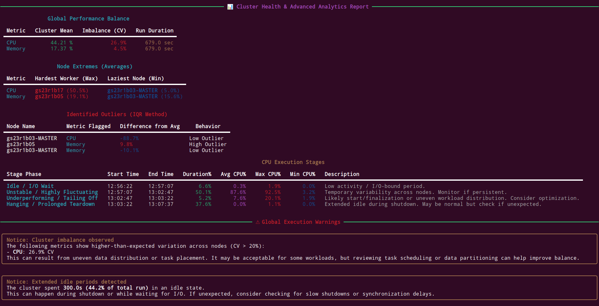

    Example of Analysis Report

The possible status of the stages are:

-  *Idle / I/O Wait* (stalled performance)
-  *Ramping / Moderate Load* (normal initialization phases)
-  *Peak Compute* (sustained high utilization)
-  *Unstable / Highly Fluctuating* (erratic scheduling or thrashing)
-  *Underperforming / Tailing Off* (gradual drop in workload efficiency)
-  *Hanging / Prolonged Teardown* (nodes refusing to release or exit)

GPU metrics use equivalent stages with GPU-specific names (e.g., *Idle / Waiting for Data*, *Underperforming / GPU Starvation*).

The report also includes a summary of the number of nodes that were detected as outliers for each metric, and the total number of nodes analyzed. It provides a quick overview of the overall health and performance of the cluster during the COMPSs run.

The analysis shows the global execution warnings that are some feedback about the overall performance of the cluster during the COMPSs run. These messages are based on the statistical analysis, the stage and outliers detection and they provide suggestions about a possible improvement of the performance of the cluster. 

.. TIP::

    The tool automatically detects if the GPU metrics are present in the CSV files and includes them in the analysis if available.