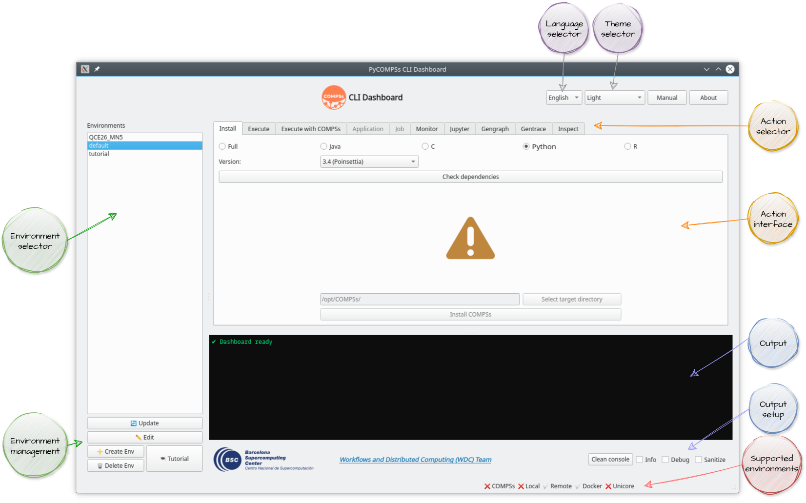
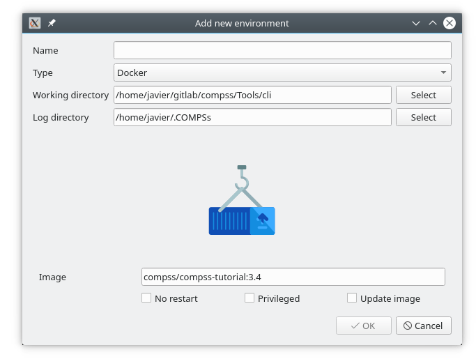
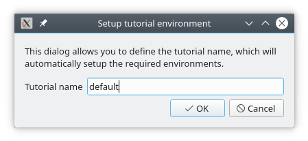
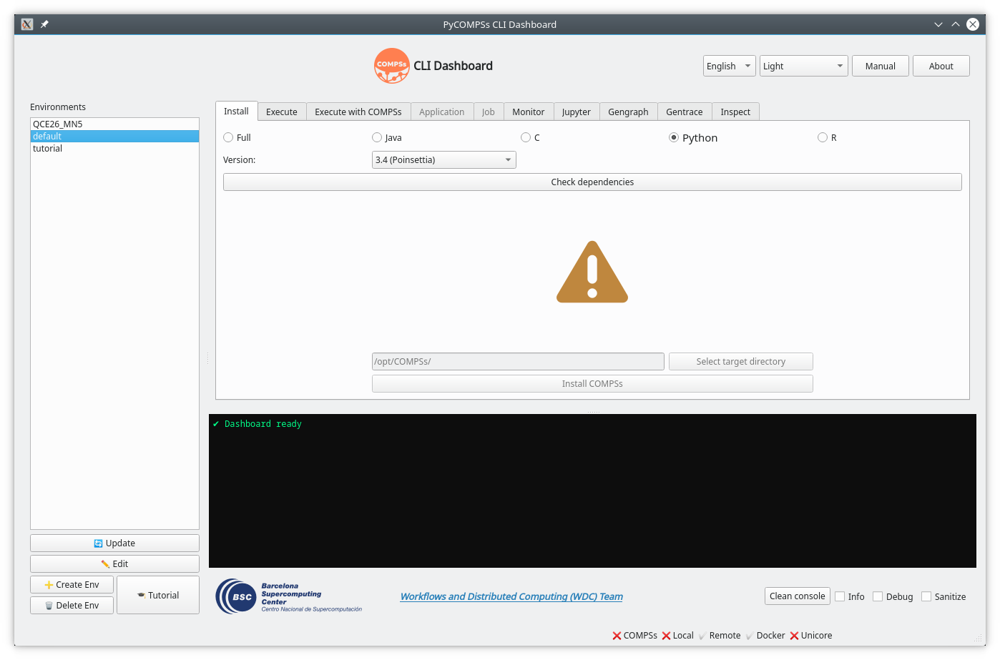
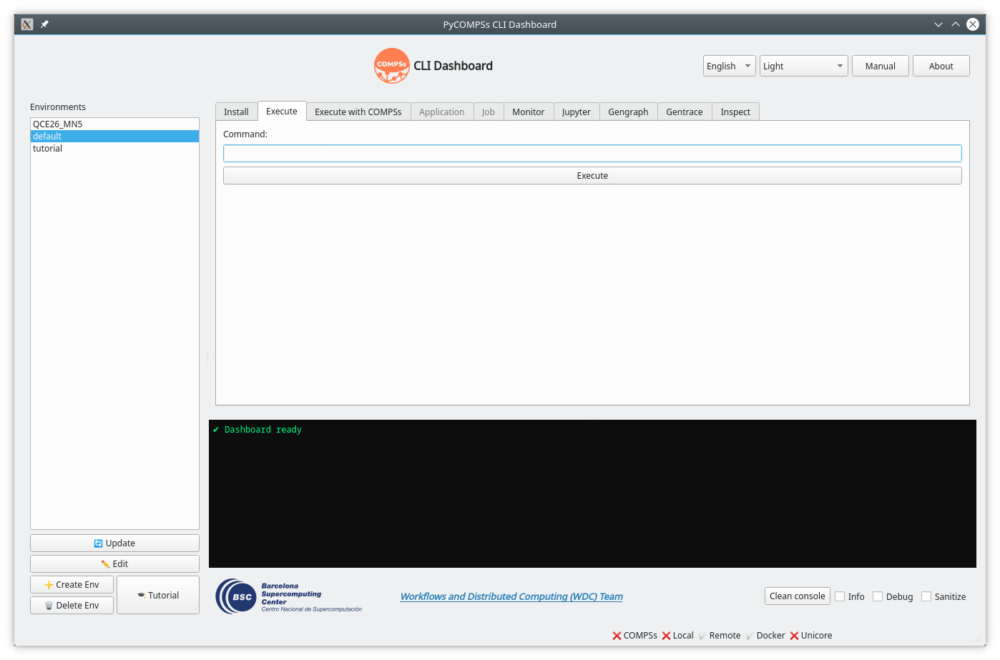
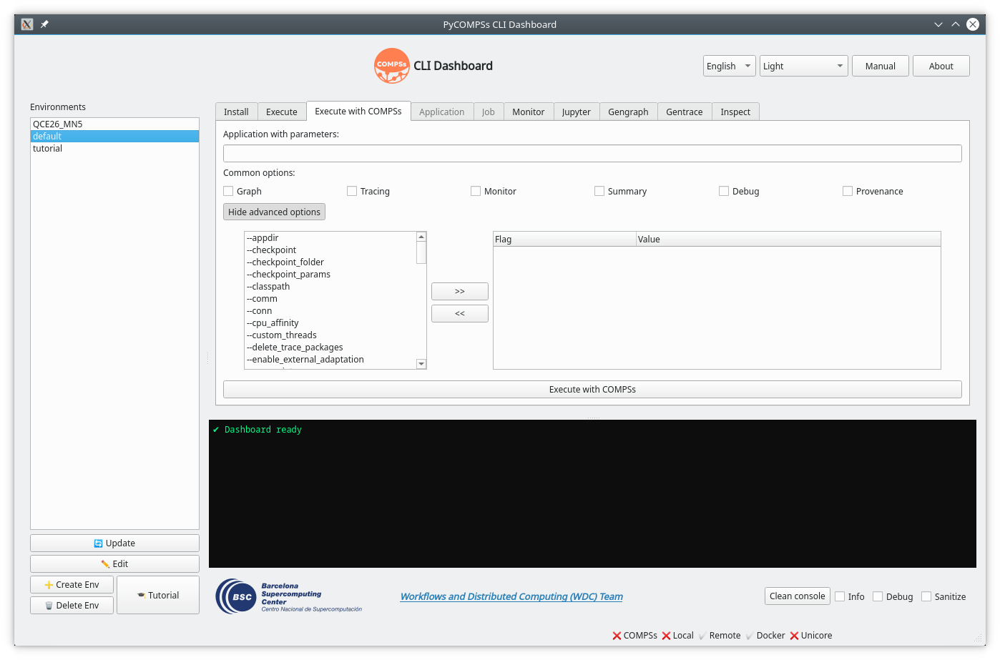
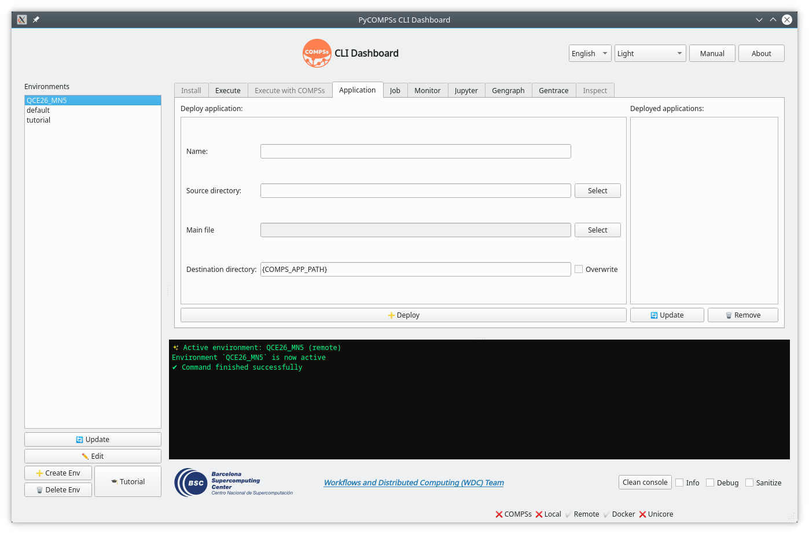
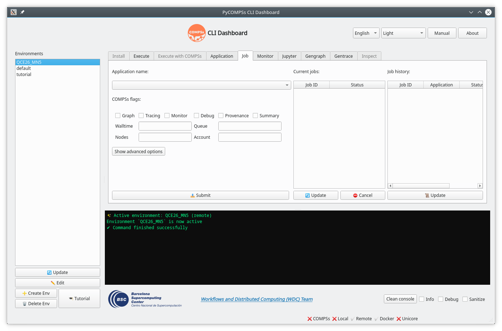
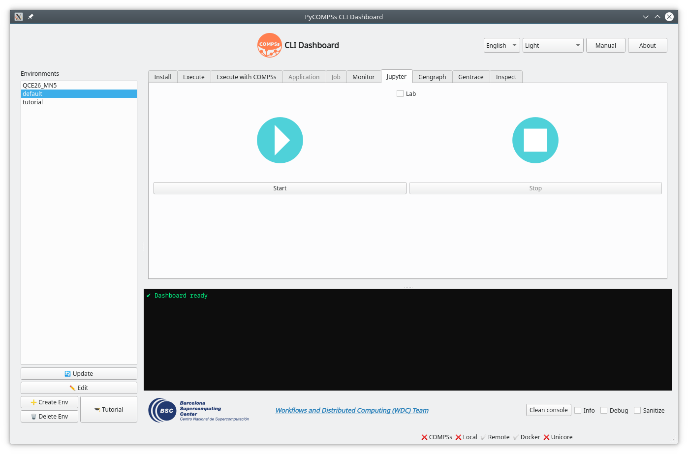
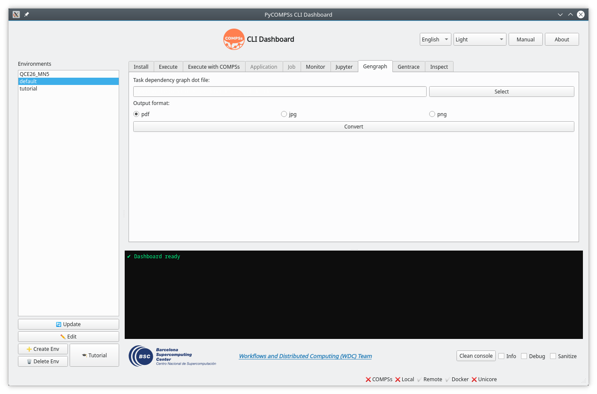

.. spelling:word-list::

   footbar
   check-boxes

Graphical User Interface
************************

If you prefer a visual experience over the terminal, the PyCOMPSs CLI includes a built-in **Graphical User Interface (GUI)**.
This tool allows you to perform all the same actions as the CLI through an intuitive, point-and-click interface.

🚀 Getting Started
==================

Launching the GUI is simple. Just run the following command in your terminal:

.. code-block:: console

   $ pycompss --gui

This will open a window where you can manage your environments, launch applications, and analyze your results without needing to remember complex command-line arguments.

   *The PyCOMPSs CLI Graphical User Interface (GUI).*

🌟 Main Features
================

The GUI is organized into several intuitive sections. Here is a detailed guide to its functionality:

Dashboard Setup
---------------

- **Language selector**: Choose your preferred language (English, Catalan, or Spanish).
- **Theme selector**: Customize the visual style of the dashboard.

Information
-----------

- **Manual**: Quick access to the official COMPSs documentation.
- **About**: Information about the development team.
- **Output**: A console-style window that displays the real-time logs of the CLI.
- **Output setup**: Options to clear the log, enable verbosity, or hide sensitive information.
- **Information**: Displays supported environments, a footbar with helpful hints, and overall progress.

Environment Management
----------------------

Avoid the need for flags by managing your execution contexts directly through the **Environment** buttons.

- **Create**: Use the initialization wizard to set up Local, Docker, Remote, or Unicore environments.
- **Switch**: Select a target environment from the dropdown menu to activate it.
- **Remove**: Delete the currently selected environment.
- **Tutorial**: Enter a tutorial name to automatically set up its associated environments and materials.

   *Adding a new environment.*

   *Setting up environments associated with a tutorial.*

Action Management
-----------------

The GUI uses a tab-based action selector that dynamically updates to show only the actions available for the currently active environment.

Install COMPSs
^^^^^^^^^^^^^^

Perform dependency checks and install COMPSs without leaving the GUI:

- **Profile selector**: Choose the installation profile (e.g., full, Java, Python, etc.).
- **Version selector**: Select the specific COMPSs version to be installed.
- **Check dependencies**: Run the dependency checker to ensure the system is ready.
- **Target directory**: Define the installation path (this field is enabled only after the dependency check succeeds).
- **Install COMPSs**: Execute the installation process.

   *Installing COMPSs through the GUI.*

Command Execution
^^^^^^^^^^^^^^^^^

Running individual commands in the active environment is as simple as entering the text and clicking **Execute**.

- **Command input**: Define the exact command to be executed.
- **Execute**: Launch the specified command.

   *Executing a command through the GUI.*

Application Execution
^^^^^^^^^^^^^^^^^^^^^

Launch COMPSs applications by defining their parameters and clicking **Execute with COMPSs**.

- **Quick Run**: Select the application file and provide the required parameters.
- **Custom Flags**: Enable options such as ``--graph`` or ``--tracing`` via simple check-boxes.
- **Advanced Options**: Expand the hidden menu to configure advanced COMPSs settings.

   *Running a COMPSs application through the GUI.*

Application Management
^^^^^^^^^^^^^^^^^^^^^^

Dedicated actions for managing applications in remote environments.

- **Name definition**: Assign a unique name to your application.
- **Source directory**: Select the local folder containing the application code.
- **Main application file**: Specify the entry point of the application.
- **Destination directory**: Define the remote path (defaults to the `.COMPSsApps` folder).
- **Deploy**: Launch the deployment process to the remote machine.
- **Application list**: A side panel that displays all deployed applications, allowing you to refresh the list or remove selected entries.

   *Application management for remote environments.*

Job Management
^^^^^^^^^^^^^^

Manage the execution of applications through remote job schedulers (e.g., SLURM).

- **Application selector**: Choose from the list of deployed applications.
- **Execution flags**: Configure COMPSs flags and job parameters (e.g., walltime, number of nodes).
- **Advanced options**: Access additional submission settings.
- **Current jobs list**: A panel showing the real-time status of submitted jobs, with options to refresh or cancel them.
- **Job history**: A log of previously executed jobs.

   *Job management for remote environments.*

Monitor
^^^^^^^^

Visualize your application's behavior in real-time using the COMPSs monitor.

- **Monitor selector**: Choose between the traditional or the new monitor.
- **Launch**: Start the monitoring service with a single click.
- **Stop**: Terminate the monitoring service.

   *COMPSs Monitor tool management.*

Jupyter
^^^^^^^^

Interact with PyCOMPSs using Jupyter notebooks.

- **Launch**: Start the Jupyter service.
- **Stop**: Stop the Jupyter service.

   *Jupyter notebook integration.*

Task Dependency Graph Generator
^^^^^^^^^^^^^^^^^^^^^^^^^^^^^^^

Convert task dependency graphs from ``dot`` format to visual formats (``pdf``, ``jpg``, or ``png``).

   *COMPSs graph converter.*

Trace Generator
^^^^^^^^^^^^^^^^

Convert execution traces generated in remote environments (``tar.gz`` files) into standard trace files (``prv``, ``pcf``, and ``row``).

   *COMPSs trace converter.*

Inspect
^^^^^^^^

The GUI provides a visual interface for the ``inspect`` command.
Load an RO-Crate (as a folder or a zip file) to explore metadata, resource usage, and task details in an organized view.

   *Exploring workflow provenance visually.*

💡 Pro Tip
==========

.. TIP::

   The GUI and the CLI are **fully synchronized**. If you activate an environment in the terminal, the GUI will recognize it immediately, and vice versa!

.. NOTE::

   Since the GUI is a wrapper around the CLI, all the requirements mentioned in the :ref:`Sections/04_Ecosystem/09_CLI/01_Requirements:Requirements` section apply here as well.